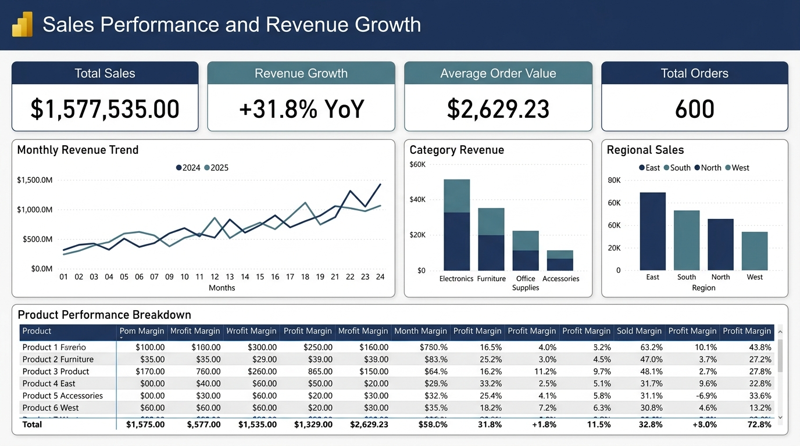

# Sales Performance and Revenue Growth Dashboard

[](#star-schema-data-model)
[](#dax-measures-and-kpi-engine)
[](#predictive-forecasting-methodology)
[](#data-preparation-and-quality-assurance)

An enterprise-grade business intelligence and analytics solution engineered to track commercial revenue velocity, evaluate gross margin efficiency, benchmark multi-period year-over-year performance, and deliver statistical revenue projections.

---

## Executive Dashboard Overview

The visual below illustrates the verified executive layout, visual field wells, and corporate styling specifications documented in the project specifications.



*Note: Visual assets are located in the `images/` directory.*

---

## Table of Contents
1. [Project Overview](#project-overview)
2. [Business Problem Statement](#business-problem-statement)
3. [Project Objectives](#project-objectives)
4. [Dataset Description and Provenance](#dataset-description-and-provenance)
5. [Data Preparation and Quality Assurance](#data-preparation-and-quality-assurance)
6. [Star Schema Data Model](#star-schema-data-model)
7. [DAX Measures and KPI Engine](#dax-measures-and-kpi-engine)
8. [Interactive Web Application](#interactive-web-application)
9. [Executive Findings and Evidence](#executive-findings-and-evidence)
10. [Predictive Forecasting Methodology](#predictive-forecasting-methodology)
11. [Repository Structure](#repository-structure)
12. [Setup and Reproduction Guide](#setup-and-reproduction-guide)
13. [Security, Governance, and Credential Management](#security-governance-and-credential-management)
14. [Documentation Library](#documentation-library)

---

## Project Overview
This repository contains the complete engineering pipeline, dimensional data modeling, DAX measure library, predictive forecasting engine, interactive web application, and business case documentation for the Sales Performance and Revenue Growth Dashboard.

Built upon a normalized 1-Fact to 5-Dimension Star Schema, this solution eliminates reporting latency, provides product-level gross margin transparency across 12 distinct product SKUs, and replaces subjective quota setting with out-of-sample backtested time-series projections.

---

## Business Problem Statement
1. **Reporting Latency and Opaque Operations:** Commercial reviews relying on static manual spreadsheets delay performance visibility by days or weeks, forcing leaders to make critical decisions based on lagging indicators.
2. **Margin Cannibalization:** High-volume product lines (such as Electronics at $571.0K) often mask lower gross margin contributions (36.09%), while lucrative high-margin accessories (51.00% margin) are under-promoted due to lack of SKU-level visibility.
3. **KPI Governance Inconsistency:** Competing spreadsheet definitions across regional units produce conflicting calculations for Net Revenue, Growth Percentage, and Quota Attainment.
4. **Subjective Target Allocation:** Absence of statistical forecasting leads to arbitrary sales quotas and misaligned inventory buffers.

---

## Project Objectives
* **Single Source of Truth:** Unify transaction logs, product master catalogs, customer cohorts, and regional hierarchies into an auditable Star Schema.
* **Complete Financial Reconciliation:** Guarantee exact parity ($0.00 variance) between source transactions, processed tabular facts, and DAX measure outputs.
* **Dynamic Time Intelligence:** Formulate defensive DAX measures supporting period-over-period and year-over-year comparative analytics across continuous calendar periods (2024 to 2025).
* **Predictive Horizon Modeling:** Engineer a statistical time-series forecasting pipeline generating 6-month forward projections with 95% confidence intervals.
* **Executive Decision Support:** Deliver an intuitive, responsive dashboard interface optimized for rapid cross-filtering and drill-down.

---

## Dataset Description and Provenance
* **Source Dataset:** `data/raw/sales_performance_dataset.csv` (Preserved in original form).
* **Provenance Classification:** Curated Synthetic Benchmark Dataset.
* **Integrity and Completeness:**
  * 600 transaction line-items spanning exactly 24 calendar months (`2024-01-01` to `2025-12-31`).
  * Zero missing values across all 21 raw columns; zero duplicate rows.
  * 4 Geographic Regions (East, West, North, South), 12 Metropolitan Areas, 8 Sales Representatives.
  * 12 distinct product SKUs across 4 categories (Electronics, Furniture, Office Supplies, Accessories).
  * Explicit customer attributes (Existing vs. New) and sales channels (Online vs. Offline).
  * Documented as synthetic demonstration data; no claim is made that this represents proprietary corporate records.

---

## Data Preparation and Quality Assurance
The pipeline is fully automated and reproducible via `scripts/clean_and_prepare_data.py`:
1. **Key Generation:** Generated deterministic business keys (`order_id`: `ORD-YYYY-XXXX`) and surrogate keys for all dimensions.
2. **Date Standardization:** Parsed ISO dates (`YYYY-MM-DD`) and integer keys (`date_key`).
3. **Product Normalization:** Extracted invariant unit costs and standard selling prices into a master catalog.
4. **Customer Cohort Normalization:** Grouped multi-dimensional attributes into 48 account profiles (`CUST-0001` to `CUST-0048`).
5. **Quality Verification:** The automated test script `scripts/validate_cleaning.py` confirms:
   * Fact Table Row Parity: Exactly 600 rows (Variance = 0).
   * Macro Financial Reconciliation: Total Revenue $1,577,535.00 (Delta = $0.00), Total Cost $935,710.00 (Delta = $0.00), Total Profit $641,825.00 (Delta = $0.00).

---

## Star Schema Data Model

```
Dim_Products (1)    ---+
                       |
Dim_Customers (1)   ---+
                       |
Dim_Date (1)        ---+---> (Many) Fact_Sales
                       |
Dim_Sales_Reps (1)  ---+
                       |
Dim_Regions (1)     ---+
```

* **Fact_Sales (600 rows):** Grain = 1 row per sales order line-item.
* **Dim_Products (12 rows):** Master SKU properties, standard costs, selling prices, and target margins.
* **Dim_Customers (48 rows):** Customer accounts across territory, state, city, segment, and channel.
* **Dim_Date (731 rows):** Continuous calendar table from 2024-01-01 to 2025-12-31 marked as the official Date Table.
* **Dim_Sales_Reps (8 rows):** Commercial representatives assigned to territories.
* **Dim_Regions (4 rows):** Primary commercial territories.
* **Relationship Integrity:** All 5 relationships are configured as One-to-Many (`1:*`) with single-direction filtering (`Dimension -> Fact`). Tested and verified zero orphan keys.

---

## DAX Measures and KPI Engine
Authored in `scripts/dax_measures.dax` and documented in `docs/dax_measures_library.md`:

```dax
// Core Measures
Total Sales = SUM(fact_sales[sales_amount])
Total Quantity = SUM(fact_sales[units_sold])
Total Orders = DISTINCTCOUNT(fact_sales[order_id])
Average Order Value = DIVIDE([Total Sales], [Total Orders], BLANK())

// Time Intelligence
Sales Previous Year = CALCULATE([Total Sales], SAMEPERIODLASTYEAR(dim_date[date]))

Revenue Growth % = 
VAR CurrentSales = [Total Sales]
VAR PriorSales = [Sales Previous Year]
RETURN IF(ISBLANK(PriorSales) || PriorSales == 0, BLANK(), DIVIDE(CurrentSales - PriorSales, PriorSales))

// Cost, Profit, and Quota Attainment
Total Cost = SUM(fact_sales[cost])
Total Profit = [Total Sales] - [Total Cost]
Profit Margin % = DIVIDE([Total Profit], [Total Sales], BLANK())
Target Sales = SUM(fact_sales[target_sales])
Sales Achievement % = DIVIDE([Total Sales], [Target Sales], BLANK())
```

---

## Interactive Web Application
In addition to Power BI modeling specifications, this project includes an interactive, browser-based analytics application:
* **Architecture:** Vanilla HTML5, CSS3, and JavaScript with zero heavy third-party framework dependencies.
* **Execution:** Served via native Python HTTP server on port 8050 (`scripts/serve_dashboard.py`).
* **Visual Capabilities:**
  * Top-row KPI summary cards with dynamic variance indicators.
  * Monthly revenue trend comparison (2024 vs. 2025 actuals vs. 2026 projections).
  * Category and regional revenue distribution charts.
  * Filter toolbar supporting live slicing across Year, Region, and Product Category.
  * Comprehensive SKU performance table with margin benchmarks.

---

## Executive Findings and Evidence
1. **Strong Revenue Expansion (+31.76% YoY):** Total annual revenue increased from $680,675.00 in 2024 to $896,860.00 in 2025 (+$216,185.00), driven by a +19.2% increase in average order value ($2,388 to $2,847) and a +10.5% gain in transaction volume (285 to 315 orders).
2. **Quarter-End Sales Velocity:** Monthly revenue demonstrates notable quarter-end surges: March 2024 ($88.6K), October 2025 ($143.8K), and December 2025 ($92.3K), reflecting deal closures aligned with commercial cycle targets.
3. **Hardware Volume vs. Accessory Margin:** Electronics is the leading revenue category ($570,950.00; 36.2% share; 36.09% gross margin), whereas Accessories delivers the highest gross margin rate (51.00% margin; $131,310.00 profit). Bundling accessories with core hardware represents a verified margin growth strategy.
4. **Stable Customer Retention (65.5% Existing Share):** Existing accounts contributed $1,034,005.00 (390 orders, AOV $2,651.29), while New customer accounts generated $543,530.00 (210 orders, AOV $2,588.24) at comparable order values.
5. **Geographic Pricing Discipline:** Revenue remains balanced across South ($425.7K), East ($424.7K), North ($391.0K), and West ($336.2K), with gross margins maintained consistently within a 40.5% to 40.9% range.

---

## Predictive Forecasting Methodology
Engineered in `scripts/forecast_engine.py` and documented in `docs/forecasting_and_growth_analysis.md`:
* **Algorithm:** Holt-Winters Exponential Smoothing with Damped Trend (`ETS_HoltWinters_Damped`).
* **Holdout Backtesting (18 Months Training / 6 Months Testing):**
  * Holt-Winters Damped: MAE $31,530.53 | RMSE $41,456.15 | MAPE 30.16%
  * Linear Trend OLS: MAE $30,948.27 | RMSE $40,844.82 | MAPE 29.60%
  * Naive Prior-Year Benchmark: MAE $38,675.00 | RMSE $43,488.47 | MAPE 41.13%
  * Validation Conclusion: Algorithmic modeling outperformed the naive prior-year baseline by 10.97 percentage points.
* **H1 2026 Forecast:** Projects $476,131.06 across January to June 2026 (95% Confidence Interval: $188,465.06 to $763,797.05). Output exported to `data/processed/revenue_forecast_h1_2026.csv`.

---

## Repository Structure

```
.
|-- .env.example                               # Environment configuration template
|-- .gitignore                                  # Git exclusion list (secrets, temp, caches)
|-- README.md                                   # Master project documentation
|-- data/
|   |-- processed/                              # Star Schema fact and dimension CSV files
|   `-- raw/                                    # Original immutable transaction dataset
|-- docs/                                       # Technical specifications and verification reports
|   |-- dashboard_layout_specification.md       # Visual design grid and field wells
|   |-- data_model_specification.md             # Star Schema relationship definitions
|   |-- data_quality_report.md                  # Cleaning logic and reconciliation
|   |-- dax_measures_library.md                 # DAX syntax, formulas, and validations
|   |-- execution_log.md                        # Phase-by-phase execution audit
|   `-- forecasting_and_growth_analysis.md      # Statistical time-series evaluation
|-- documentation/                              # Strategic executive business case artifacts
|   |-- business_case/                          # ROI models, market research, and claim register
|   |-- github_deployment_guide.md              # Version control protocol
|   `-- publishing_guide.md                     # Power BI Service configuration guide
|-- images/                                     # Visual assets and dashboard screenshots
|   |-- .gitkeep
|   `-- dashboard_overview.jpg                  # High-fidelity dashboard interface preview
|-- screenshots/                                # Archive screenshots
`-- scripts/                                    # Automated Python ETL, models, and test suites
    |-- clean_and_prepare_data.py               # Data cleansing and dimensional split
    |-- dax_measures.dax                        # Raw DAX measure definitions
    |-- forecast_engine.py                      # Holt-Winters ETS forecasting engine
    |-- power_query_importer.m                  # Power Query M ingestion expressions
    |-- powerbi_theme.json                      # Corporate visual palette configuration
    |-- serve_dashboard.py                      # Local web server runner
    `-- validate_*.py                           # Automated test suites
```

---

## Setup and Reproduction Guide

### Prerequisites
* Python 3.10+ (Standard Python or Anaconda)
* Optional: Microsoft Power BI Desktop (for .pbix import)

### 1. Preprocessing and Quality Validation
```bash
# Clean raw transaction data and generate Star Schema tables
python scripts/clean_and_prepare_data.py

# Validate row counts, referential integrity, and zero financial delta
python scripts/validate_cleaning.py
```

### 2. Dimensional Model and DAX Measure Validation
```bash
# Validate Star Schema grains and single-direction relationships
python scripts/validate_data_model.py

# Validate DAX measure mathematical parity and edge-case handling
python scripts/validate_dax_measures.py
```

### 3. Forecasting and Interaction Validation
```bash
# Run statistical forecast engine and export H1 2026 projections
python scripts/forecast_engine.py

# Validate time-series backtesting metrics
python scripts/validate_forecasting.py

# Verify dashboard slicer cross-filtering and chronological sorting
python scripts/validate_dashboard_interactions.py
```

### 4. Launch Local Web Dashboard
```bash
# Start local dashboard server on http://localhost:8050
python scripts/serve_dashboard.py
```
Open a browser and navigate to `http://localhost:8050`.

---

## Security, Governance, and Credential Management
* **Zero Credential Exposure:** This repository contains no hardcoded passwords, personal access tokens, database credentials, or secret keys.
* **Environment Configuration:** All local configurations and credentials must be maintained in `.env` (excluded via `.gitignore`). Use `.env.example` as a template.
* **Data Minimization:** No personal identifiable information (PII) is included in the synthetic transaction records.

---

## Documentation Library

| Document | Primary Focus | File Reference |
| :--- | :--- | :--- |
| Business Case Proposal | Strategic objectives, user personas, and investment criteria | [business_case.md](documentation/business_case/business_case.md) |
| Claim Validation Register | Market size, market share, and productivity claims audit | [claim_validation_register.md](documentation/business_case/claim_validation_register.md) |
| Technical Architecture | End-to-end data pipeline, refresh schedule, and security | [technical_architecture.md](documentation/business_case/technical_architecture.md) |
| Financial ROI Framework | Economic payback calculations and sensitivity model | [roi_framework.md](documentation/business_case/roi_framework.md) |
| Service Publishing Guide | Power BI Service deployment, workspace roles, and gateway | [publishing_guide.md](documentation/publishing_guide.md) |
| Data Model Specification | Star Schema diagram, grain definitions, and relationship keys | [data_model_specification.md](docs/data_model_specification.md) |
| DAX Measures Library | Full DAX measure code, formulas, and edge-case behaviors | [dax_measures_library.md](docs/dax_measures_library.md) |
| Dashboard Layout Spec | Layout grid, visual field wells, sort orders, and theme | [dashboard_layout_specification.md](docs/dashboard_layout_specification.md) |
| Forecasting Analysis | Holt-Winters model, error metrics, and H1 2026 forecast | [forecasting_and_growth_analysis.md](docs/forecasting_and_growth_analysis.md) |
| Data Quality Report | Transformation rules, cleansing logs, and reconciliation | [data_quality_report.md](docs/data_quality_report.md) |
| Execution Log | Phase-by-phase implementation and verification audit trail | [execution_log.md](docs/execution_log.md) |
