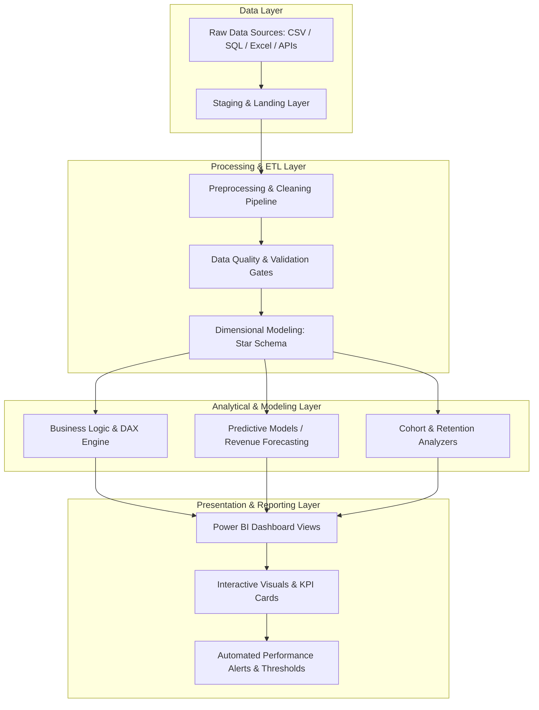

# System Architecture

## 1. Overview
The **Sales Performance & Revenue Growth Dashboard** is designed to provide actionable business intelligence, revenue tracking, customer cohort analysis, and predictive growth projections.

---

## 2. Architectural Blueprint

---

## 3. Layer Specifications

### 3.1 Data Ingestion & Storage Layer
- **Responsibility:** Ingest raw transactions, customer records, product catalogs, and geographical master data.
- **Components:** Raw files/connectors, staging tables, and partitioned datasets.

### 3.2 Processing & ETL Layer
- **Responsibility:** Sanitize raw inputs, handle missing values, format temporal fields, and conform schemas.
- **Design:** Star Schema model separating transactional facts (`Fact_Sales`) from dimension tables (`Dim_Date`, `Dim_Customer`, `Dim_Product`, `Dim_Region`).

### 3.3 Analytical & Modeling Layer
- **Responsibility:** Calculate core KPIs (MRR, ARR, YoY/MoM growth, churn rate, Customer Acquisition Cost, Customer Lifetime Value) and train predictive models for future sales forecasting.
- **Components:** Power BI DAX calculation engine, Python/R statistical modeling libraries (e.g., Prophet, Scikit-Learn, LightGBM).

### 3.4 Presentation Layer
- **Responsibility:** High-impact, responsive, and intuitive executive dashboards.
- **Components:** Executive Overview, Sales Performance, Regional Breakdown, Customer Segmentation, and Predictive Growth Forecasting.

---

## 4. Technology Stack & Environment
- **Core Analytics & Visualization:** Microsoft Power BI / DAX / Power Query (M)
- **Data Engineering / Modeling:** Python (Pandas, NumPy, Scikit-Learn, Statsmodels)
- **Data Storage:** Parquet / CSV / Relational DB
- **Documentation & Tracking:** Markdown specifications located in `docs/`
