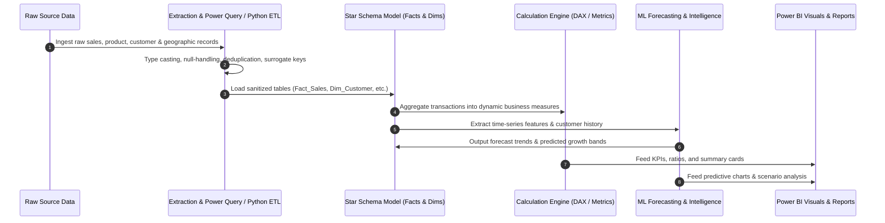

# Data Flow & Pipeline Architecture

## 1. End-to-End Data Pipeline

---

## 2. Pipeline Stages

### Stage 1: Extraction & Ingestion
- Ingest raw transactional files with proper encoding and schema detection.
- Log raw record counts and integrity checksums before transformation.

### Stage 2: Transformation & Cleansing (ETL)
- **Deduplication:** Remove repeated transaction IDs.
- **Null & Anomaly Imputation:** Handle missing customer IDs, price discrepancies, and negative quantities where applicable.
- **Normalization:** Enforce standardized ISO dates (`YYYY-MM-DD`), phone/email formats, and currency conversions.
- **Surrogate Keys:** Generate surrogate keys for SCD (Slowly Changing Dimensions) where applicable.

### Stage 3: Data Model Formulation (Star Schema)
- **Fact Tables:**
  - `Fact_Sales`: Transaction ID, DateKey, CustomerKey, ProductKey, RegionKey, Units, UnitPrice, Discount, TotalRevenue, Margin.
- **Dimension Tables:**
  - `Dim_Date`: DateKey, FullDate, Year, Quarter, Month, MonthName, Week, DayOfWeek, IsWeekend.
  - `Dim_Customer`: CustomerKey, CustomerID, CustomerName, Segment, Country, JoinDate.
  - `Dim_Product`: ProductKey, ProductID, ProductName, Category, SubCategory, UnitCost, BasePrice.
  - `Dim_Region`: RegionKey, Territory, Country, RegionName, Manager.

### Stage 4: Semantic Layer & Metrics Derivation
- DAX measures evaluating contextual filters (Time Intelligence, YoY, MoM, Cumulative Totals).

### Stage 5: Reporting & Export
- Visualization consumption, drill-through paths, and automated data refresh.
