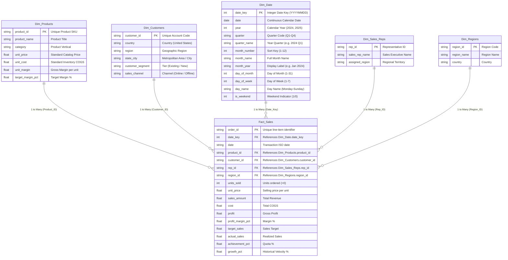

# Power BI Data Model Specification (Star Schema)

**Project:** Sales Performance & Revenue Growth Dashboard  
**Phase:** Phase 3 — Data Modeling  
**Role:** Senior Power BI Data Modeler  
**Status:** Validated Technical Specification & Ingestion Blueprint  

---

## 1. Architectural Star Schema Diagram



---

## 2. Table Grains & Key Definitions

| Table | Logical Role | Granularity (Grain) | Primary Key (1-Side) | Row Count |
| :--- | :--- | :--- | :--- | :--- |
| **`Fact_Sales`** | Central Fact Table | **One row per sales order line-item** | `order_id` (`ORD-YYYY-XXXX`) | 600 |
| **`Dim_Products`** | Dimension | **One row per distinct product SKU** | `product_id` (`PRD-XXX-XXX`) | 12 |
| **`Dim_Customers`**| Dimension | **One row per customer account profile** | `customer_id` (`CUST-XXXX`) | 48 |
| **`Dim_Date`** | Dimension | **One row per calendar day** | `date_key` (`YYYYMMDD`) / `date` | 731 |
| **`Dim_Sales_Reps`**| Dimension | **One row per sales executive** | `rep_id` (`REP-XXX`) | 8 |
| **`Dim_Regions`** | Dimension | **One row per geographical sales territory** | `region_id` (`REG-XX`) | 4 |

---

## 3. Relationship Matrix & Cardinality Specifications

All relationships are configured as **1-to-many (`1:*`)** with **Single-direction filtering** from Dimension to Fact. This guarantees optimal VertiPaq compression, eliminates circular relationship paths, and avoids ambiguous filter transitions.

| Primary Table (1-Side) | Foreign Key Table (*-Side) | Join Key (1-Side) | Join Key (*-Side) | Cardinality | Filter Direction | State | Security Filtering |
| :--- | :--- | :--- | :--- | :--- | :--- | :--- | :--- |
| `Dim_Products` | `Fact_Sales` | `product_id` | `product_id` | `1 : *` | Single (`Dim` -> `Fact`) | Active | None |
| `Dim_Customers`| `Fact_Sales` | `customer_id` | `customer_id` | `1 : *` | Single (`Dim` -> `Fact`) | Active | None |
| `Dim_Date` | `Fact_Sales` | `date_key` | `date_key` | `1 : *` | Single (`Dim` -> `Fact`) | Active | None |
| `Dim_Sales_Reps`| `Fact_Sales` | `rep_id` | `rep_id` | `1 : *` | Single (`Dim` -> `Fact`) | Active | None |
| `Dim_Regions` | `Fact_Sales` | `region_id` | `region_id` | `1 : *` | Single (`Dim` -> `Fact`) | Active | None |

> [!NOTE]
> Alternative relationship: If joining `Dim_Date` on ISO Date format rather than integer `date_key`, link `Dim_Date[date] 1 -> * Fact_Sales[date]` as an Active `1:*` relationship. Both keys are validated 100% unique and consistent.

---

## 4. Calendar Dimension & DAX Definition

In addition to the pre-generated tabular file [`data/processed/dim_date.csv`](file:///d:/Power%20BI/Sales%20Performance%20&%20Revenue%20Growth%20Dashboard/data/processed/dim_date.csv), the following DAX formula can be used to generate the Calendar table natively within Power BI:

```dax
Dim_Date = 
VAR MinYear = 2024
VAR MaxYear = 2025
VAR BaseCalendar = CALENDAR(DATE(MinYear, 1, 1), DATE(MaxYear, 12, 31))
RETURN
    GENERATE(
        BaseCalendar,
        VAR CurrentDate = [Date]
        RETURN
            ROW(
                "date_key", INT(FORMAT(CurrentDate, "YYYYMMDD")),
                "Year", YEAR(CurrentDate),
                "Quarter", "Q" & FORMAT(CurrentDate, "Q"),
                "quarter_name", FORMAT(CurrentDate, "YYYY") & " Q" & FORMAT(CurrentDate, "Q"),
                "month_number", MONTH(CurrentDate),
                "month_name", FORMAT(CurrentDate, "MMMM"),
                "month_year", FORMAT(CurrentDate, "mmm YYYY"),
                "year_month_sort", YEAR(CurrentDate) * 100 + MONTH(CurrentDate),
                "day_of_month", DAY(CurrentDate),
                "day_of_week", WEEKDAY(CurrentDate, 2), -- 1 = Monday, 7 = Sunday
                "day_name", FORMAT(CurrentDate, "dddd"),
                "is_weekend", IF(WEEKDAY(CurrentDate, 2) >= 6, 1, 0)
            )
    )
```

### Calendar Configuration in Power BI:
1. **Sort Column Settings:**
   - Set `month_name` column to **Sort by Column** -> `month_number`.
   - Set `month_year` column to **Sort by Column** -> `year_month_sort`.
   - Set `quarter` column to **Sort by Column** -> `quarter`.
2. **Mark as Date Table:**
   - Right-click `Dim_Date` -> select **Mark as Date Table**.
   - Choose `Date` as the unique date identifier column.

---

## 5. Model Validation Results

Executed via automated test suite [`scripts/validate_data_model.py`](file:///d:/Power%20BI/Sales%20Performance%20&%20Revenue%20Growth%20Dashboard/scripts/validate_data_model.py):

| Test ID | Objective | Validated Evidence | Status |
| :--- | :--- | :--- | :--- |
| `TC-MDL-01` | Fact Table Grain Verification | 600 unique `order_id` keys out of 600 rows (0 nulls) | **PASS** |
| `TC-MDL-02` | Products 1-Side Key Uniqueness | 12 unique SKUs out of 12 records (0 duplicates) | **PASS** |
| `TC-MDL-03` | Customers 1-Side Key Uniqueness | 48 unique accounts out of 48 records (0 duplicates) | **PASS** |
| `TC-MDL-04` | Calendar 1-Side Key Uniqueness | 731 unique dates out of 731 records (0 duplicates) | **PASS** |
| `TC-MDL-05` | Sales Reps & Regions 1-Side Uniqueness | Reps: 8 unique; Regions: 4 unique (0 duplicates) | **PASS** |
| `TC-MDL-06` | Referential Integrity (Orphan Foreign Keys) | **0 orphans** across Product, Customer, Date, Rep, and Region | **PASS** |
| `TC-MDL-07` | Calendar Coverage & Continuity | Continuous 731 days (2024-01-01 to 2025-12-31; zero gaps) | **PASS** |
| `TC-MDL-08` | Calendar Required Fields Presence | `date`, `year`, `month_number`, `month_name`, `quarter`, `month_year`, `date_key` verified | **PASS** |
| `TC-MDL-09` | Star Schema Single-Direction Filtering | 5/5 relationships verified `1:*` single-direction | **PASS** |
| `TC-MDL-10` | Fact Date Range Boundary Bounding | Fact dates (`2024-01-01` to `2025-12-31`) strictly bounded | **PASS** |

---

## 6. Manual Power BI Desktop Implementation Steps Still Required

Because Power BI Desktop is not detected as an active binary in this headless CLI environment, the physical `.pbix` model file must be opened or created in Power BI Desktop following these straightforward steps:

### Step 1: Ingest Data via Power Query
1. Open **Power BI Desktop**.
2. Select **Get Data** -> **Text/CSV**.
3. Ingest the following 6 processed CSV files from `D:\Power BI\Sales Performance & Revenue Growth Dashboard\data\processed\`:
   - `fact_sales.csv`
   - `dim_products.csv`
   - `dim_customers.csv`
   - `dim_sales_reps.csv`
   - `dim_regions.csv`
   - `dim_date.csv` (or generate via DAX using Section 4 above)
4. Confirm data types match the specifications in [`docs/dataset.md`](file:///d:/Power%20BI/Sales%20Performance%20&%20Revenue%20Growth%20Dashboard/docs/dataset.md). Click **Close & Apply**.

### Step 2: Establish Model Relationships
1. Switch to the **Model View** (left navigation bar).
2. Drag and drop to establish the 5 relationships as specified in the **Relationship Matrix (Section 3)**:
   - `dim_products[product_id]` $\rightarrow$ `fact_sales[product_id]`
   - `dim_customers[customer_id]` $\rightarrow$ `fact_sales[customer_id]`
   - `dim_date[date_key]` $\rightarrow$ `fact_sales[date_key]`
   - `dim_sales_reps[rep_id]` $\rightarrow$ `fact_sales[rep_id]`
   - `dim_regions[region_id]` $\rightarrow$ `fact_sales[region_id]`
3. Double-click each relationship line and verify:
   - **Cardinality:** `One to many (1:*)`
   - **Cross filter direction:** `Single`
   - **Make this relationship active:** Checked

### Step 3: Configure Calendar Properties
1. Select `dim_date` in the Data pane.
2. Select `month_name` -> in the **Column tools** ribbon, click **Sort by column** -> select `month_number`.
3. Select `month_year` -> click **Sort by column** -> select `year_month_sort` (or `date_key`).
4. Right-click `dim_date` -> select **Mark as date table** -> choose `date`.
