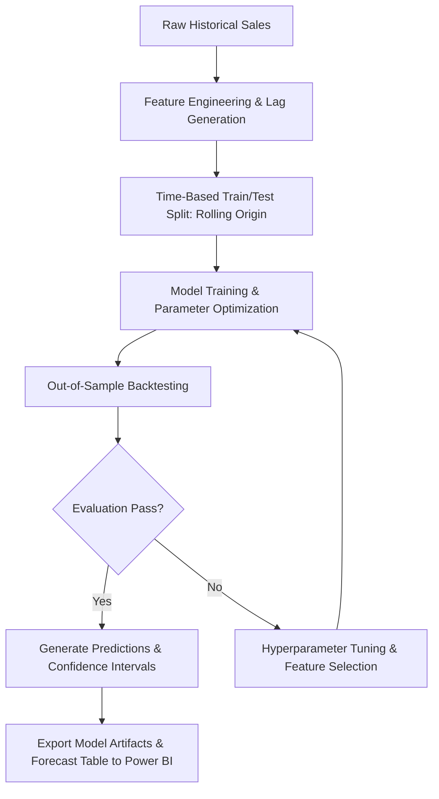

# Model & Analytics Learning Methodology

This document outlines the statistical learning, machine learning, and time-series forecasting frameworks implemented to project revenue growth and evaluate sales performance.

---

## 1. Objectives & Formulations
- **Primary Objective:** Predict future net revenue trends ($y_{t+h}$) over a defined forecasting horizon $h$ (30, 60, 90 days / 12 months) with high accuracy and tight prediction intervals.
- **Secondary Objective:** Identify customer churn probability and customer lifetime value (LTV).

---

## 2. Mathematical Modeling & Algorithms

### 2.1 Time-Series Decomposition & Forecasting
The revenue time-series $Y(t)$ is decomposed into:
$$Y(t) = T(t) + S(t) + H(t) + \epsilon_t$$

Where:
- $T(t)$: Trend component (macro growth or shrinkage over time).
- $S(t)$: Seasonality component (weekly, monthly, quarterly sales spikes, e.g., end-of-quarter push).
- $H(t)$: Holiday / promotional effect (Black Friday, fiscal close).
- $\epsilon_t$: Residual error term / Gaussian white noise.

### 2.2 Model Candidates
1. **Prophet / Additive Regressive Models:**
   - Robust to missing dates, shifts in trends, and complex multi-period seasonalities.
   - Outputs uncertainty intervals via Monte Carlo simulation on trend and residual variance.
2. **Gradient Boosted Decision Trees (LightGBM / XGBoost):**
   - Incorporates lag features ($Y_{t-1}, Y_{t-7}, Y_{t-30}$), rolling statistics (7-day/30-day moving average and standard deviation), and exogenous macroeconomic/marketing variables.
3. **Exponential Smoothing (ETS / Holt-Winters):**
   - Fast, interpretable statistical baseline for low-latency Power BI native forecasting.

---

## 3. Training & Validation Workflow

---

## 4. Feature Engineering
- **Temporal Features:** Day of week, month, day of month, quarter, days to end-of-quarter, holidays.
- **Lagged Values:** Revenue at $t-1, t-7, t-14, t-30, t-365$.
- **Window Aggregations:** Rolling mean, rolling min, rolling max, rolling standard deviation over 7-day and 30-day horizons.
- **Categorical Encodings:** Target encoding or one-hot encoding for high-volume product categories and geographical regions.

---

## 5. Loss Functions & Evaluation Metrics

To ensure mathematical precision, models are scored against:

1. **Mean Absolute Percentage Error (MAPE):**
   $$\text{MAPE} = \frac{100\%}{n} \sum_{t=1}^{n} \left| \frac{y_t - \hat{y}_t}{y_t} \right|$$
   - Target: $\text{MAPE} < 8.0\%$ for 30-day forecasts.

2. **Root Mean Squared Error (RMSE):**
   $$\text{RMSE} = \sqrt{\frac{1}{n} \sum_{t=1}^{n} (y_t - \hat{y}_t)^2}$$
   - Penalizes large variance spikes and unexpected drawdowns.

3. **Weighted Absolute Percentage Error (WAPE):**
   $$\text{WAPE} = \frac{\sum |y_t - \hat{y}_t|}{\sum y_t}$$
   - Stable against periods with zero or near-zero daily sales.

---

## 6. Model Retraining & Drift Monitoring
- **Trigger:** Monthly scheduled retraining or when rolling 14-day MAPE degrades beyond 12%.
- **Output Artifacts:** Staged forecast tables loaded into the Power BI semantic model containing `ForecastDate`, `PredictedRevenue`, `LowerConfidenceBound`, `UpperConfidenceBound`.
