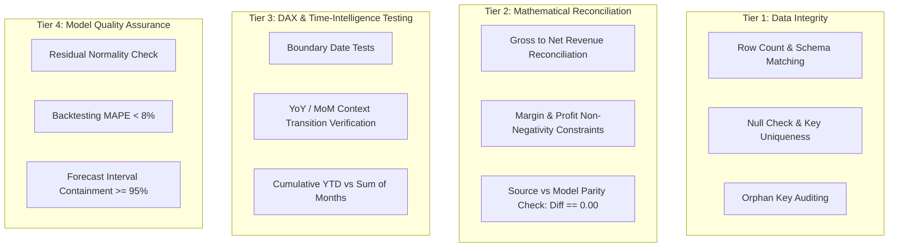

# Validation & Verification Framework

This document outlines the rigorous testing standards, data reconciliation checkpoints, unit assertions, and acceptance criteria required to validate that every implementation phase is mathematically and technically sound.

---

## 1. Multi-Tier Validation Protocol



---

## 2. Validation Checkpoints & Assertions

### Checkpoint 1: Ingestion & Schema Parity
| Test ID | Test Objective | Validation Query / Logic | Success Criteria |
| :--- | :--- | :--- | :--- |
| `TC-ING-01` | Row Count Verification | `COUNT(Source_Rows) == COUNT(Fact_Sales)` | Exact match (0 discrepancy) |
| `TC-ING-02` | Primary Key Uniqueness | `COUNT(SalesKey) - COUNT(DISTINCT SalesKey)` | Must equal `0` |
| `TC-ING-03` | Foreign Key Referential Integrity | Orphan check on `CustomerKey`, `ProductKey`, `DateKey` | `0` unmatched foreign keys |

---

### Checkpoint 2: Financial & Metric Reconciliation
| Test ID | Test Objective | Mathematical Formula | Success Criteria |
| :--- | :--- | :--- | :--- |
| `TC-FIN-01` | Net Revenue Reconciliation | $\sum \text{NetRevenue} = \sum (\text{Quantity} \times \text{UnitPrice} \times (1 - \text{Discount}))$ | Variance $< 0.01$ |
| `TC-FIN-02` | Profit Parity | $\sum \text{Profit} = \sum \text{NetRevenue} - \sum \text{TotalCost}$ | Variance $< 0.01$ |
| `TC-FIN-03` | Discount Bounds | $\text{MIN}(\text{Discount}) \ge 0 \land \text{MAX}(\text{Discount}) \le 1.00$ | Zero violations |

---

### Checkpoint 3: DAX Measure Sanity Tests
To validate DAX formulas directly within Power BI or DAX Studio:

```dax
-- Test: Cumulative YTD vs Sum of Constituent Months
EVALUATE
VAR SelectedYear = 2024
VAR MonthlySum = 
    CALCULATE(
        [Total Net Revenue],
        FILTER(ALL('Dim_Date'), 'Dim_Date'[Year] = SelectedYear && 'Dim_Date'[MonthNumber] <= 12)
    )
VAR YTDCalculation = 
    CALCULATE(
        [Revenue YTD],
        FILTER(ALL('Dim_Date'), 'Dim_Date'[Year] = SelectedYear && 'Dim_Date'[MonthNumber] = 12)
    )
RETURN
    ROW(
        "MonthlySum", MonthlySum,
        "YTDCalculation", YTDCalculation,
        "Difference", MonthlySum - YTDCalculation,
        "Status", IF(ROUND(MonthlySum - YTDCalculation, 2) = 0, "PASSED", "FAILED")
    )
```

---

### Checkpoint 4: Predictive Model Quality Checks
- **Out-of-Sample Performance:** Backtest models on the latest 90-day unseen partition.
- **Evaluation Gate:**
  - $\text{MAPE} \le 8\%$
  - $\text{Forecast Bias} = \frac{\sum (\hat{y}_t - y_t)}{\sum y_t} \in [-3\%, +3\%]$
  - Prediction interval coverage: $\ge 95\%$ of actual historical data points fall within the $[Lower\_Bound, Upper\_Bound]$ 95% interval.

---

## 3. Implementation Verification Checklist
Every implementation update submitted must confirm:
- [ ] Source data matches loaded fact table record counts.
- [ ] Dimensional relationships maintain 1-to-many cardinality with no bidirectional loops.
- [ ] Financial metrics reconcile to the cent with source transaction summaries.
- [ ] DAX measures return non-error values under empty or multi-filtered context.
- [ ] Verification script outputs logged in [Execution Log](file:///d:/Power%20BI/Sales%20Performance%20&%20Revenue%20Growth%20Dashboard/docs/execution_log.md).
