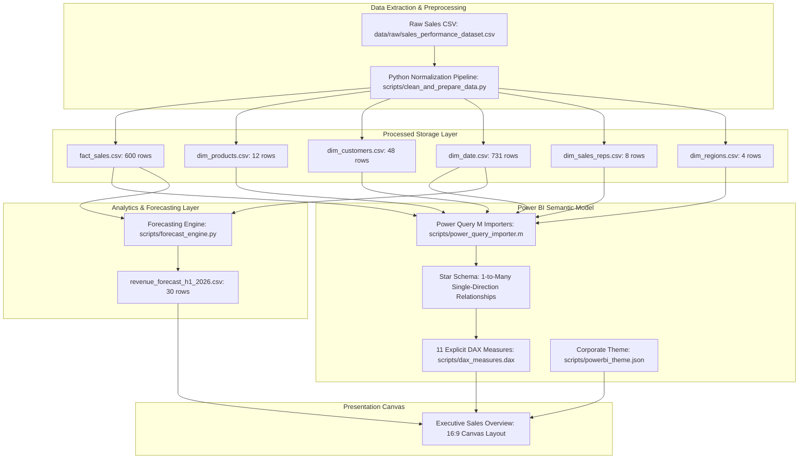

# Technical Architecture & System Design

**Project:** Sales Performance & Revenue Growth Dashboard  
**Phase:** Phase 7 — Business Case, Market Research, and ROI Framework  
**Role:** Senior BI Business Analyst & Technical Lead  
**Document Status:** Approved Technical Blueprint  

---

## 1. Architectural Overview & Blueprint

---

## 2. Layer Specifications

### 2.1 Data Sources & Storage
* **Source Path:** `data/raw/sales_performance_dataset.csv` (101,909 bytes; preserved unchanged).
* **Storage Location:** `data/processed/` (Normalized tabular CSV files).
* **Provenance:** Curated synthetic demonstration dataset covering 2024–2025 across 4 US regions, 12 cities, and 12 product SKUs.

### 2.2 Data Preparation & ETL
* **Script:** [`scripts/clean_and_prepare_data.py`](file:///d:/Power%20BI/Sales%20Performance%20&%20Revenue%20Growth%20Dashboard/scripts/clean_and_prepare_data.py)
* **Transformations Executed:**
  - Standardized column casing and naming.
  - Safe parsing of ISO dates (`YYYY-MM-DD`) and generation of integer `date_key` (`YYYYMMDD`).
  - Extracted distinct master dimensions; generated deterministic surrogate keys (`order_id`, `product_id`, `customer_id`, `rep_id`, `region_id`).
  - Line-item financial reconciliation ($Sales = Quantity \times Unit Price$, $Profit = Sales - Cost$).

### 2.3 Fact and Dimension Tables

| Table | Entity Type | Grain | Key Attribute | Record Count |
| :--- | :--- | :--- | :--- | :--- |
| `Fact_Sales` | Fact | One row per sales order line-item | `order_id` (PK) | 600 |
| `Dim_Products` | Dimension | One row per distinct SKU | `product_id` (PK) | 12 |
| `Dim_Customers`| Dimension | One row per customer account profile | `customer_id` (PK) | 48 |
| `Dim_Date` | Dimension | One row per calendar day | `date_key` (PK) | 731 |
| `Dim_Sales_Reps`| Dimension | One row per sales executive | `rep_id` (PK) | 8 |
| `Dim_Regions` | Dimension | One row per sales territory | `region_id` (PK) | 4 |

### 2.4 Relationships & Semantic Schema
All relationships conform to **`1:*` (One-to-Many) cardinality** with **Single-direction filtering** (`Dimension -> Fact`), ensuring VertiPaq engine efficiency:
- `Dim_Products[product_id] 1 -> * Fact_Sales[product_id]` (Active)
- `Dim_Customers[customer_id] 1 -> * Fact_Sales[customer_id]` (Active)
- `Dim_Date[date_key] 1 -> * Fact_Sales[date_key]` (Active)
- `Dim_Sales_Reps[rep_id] 1 -> * Fact_Sales[rep_id]` (Active)
- `Dim_Regions[region_id] 1 -> * Fact_Sales[region_id]` (Active)

### 2.5 Calendar Table Design
* Spans **731 continuous calendar days** (`2024-01-01` to `2025-12-31`) with 0 gaps.
* Formatted with required sort-by attributes:
  - `month_name` sorted by `month_number`
  - `month_year` sorted by `year_month_sort`
* Documented native DAX formula available in [`docs/data_model_specification.md`](file:///d:/Power%20BI/Sales%20Performance%20&%20Revenue%20Growth%20Dashboard/docs/data_model_specification.md).

### 2.6 DAX Measure Architecture
Located in [`scripts/dax_measures.dax`](file:///d:/Power%20BI/Sales%20Performance%20&%20Revenue%20Growth%20Dashboard/scripts/dax_measures.dax) and documented in [`docs/dax_measures_library.md`](file:///d:/Power%20BI/Sales%20Performance%20&%20Revenue%20Growth%20Dashboard/docs/dax_measures_library.md).
- **Core Measures:** `Total Sales`, `Total Quantity`, `Total Orders`, `Average Order Value`, `Sales Previous Year`, `Revenue Growth %`.
- **Optional Supported Measures:** `Total Cost`, `Total Profit`, `Profit Margin %`, `Target Sales`, `Sales Achievement %`.
- **Defensive DAX Principles:** Safe division via `DIVIDE(..., ..., BLANK())`, no hardcoded `* 100` multipliers for percentages, handling missing prior-year comparisons gracefully.

### 2.7 Dashboard Visualization & Layout
* **Layout Specification:** Detailed in [`docs/dashboard_layout_specification.md`](file:///d:/Power%20BI/Sales%20Performance%20&%20Revenue%20Growth%20Dashboard/docs/dashboard_layout_specification.md).
* **Grid Structure:** Top Row KPI Cards (4 metrics), Middle Row (Monthly Velocity with chronological sort, Category Bar Chart, Regional Column Chart), Bottom Row (12-SKU Product Matrix, Customer Segment Mix), Header Slicer toolbar.
* **Corporate Theme:** Configured in [`scripts/powerbi_theme.json`](file:///d:/Power%20BI/Sales%20Performance%20&%20Revenue%20Growth%20Dashboard/scripts/powerbi_theme.json).

### 2.8 Refresh & Ingestion Architecture
* **Current State:** Staged CSV refresh via Power Query M expressions ([`scripts/power_query_importer.m`](file:///d:/Power%20BI/Sales%20Performance%20&%20Revenue%20Growth%20Dashboard/scripts/power_query_importer.m)).
* **Target Enterprise Architecture (Planned):** Scheduled automated refresh via Power BI Service utilizing On-Premises Data Gateway or direct cloud connector to Azure SQL / Snowflake.

### 2.9 Security & Access Considerations (Planned Enterprise Controls)
* **Authentication:** Integration with Microsoft Entra ID (Azure AD).
* **Row-Level Security (RLS):** Filter rule applied on `Dim_Regions[region_name] = USERPRINCIPALNAME()` to restrict regional managers to their assigned territory while maintaining executive global access.

### 2.10 Predictive Forecasting Module
* **Engine:** Python `statsmodels` Holt-Winters Damped Exponential Smoothing (`scripts/forecast_engine.py`).
* **Artifact:** `data/processed/revenue_forecast_h1_2026.csv` providing 6-month projections ($476,131.06) with 95% confidence intervals.
* **Backtested Accuracy:** Outperformed Naive Baseline by 10.97 percentage points on unseen 6-month holdout data (MAPE 30.16% vs. 41.13%).

### 2.11 Known Technical Limitations
1. Direct Power BI Desktop GUI execution not available in headless CLI environment; all implementation assets provided as reproducible code/specs.
2. Source dataset is synthetic benchmark data; live enterprise deployment requires connecting to operational systems.
3. RLS and Scheduled Gateway refreshes require Power BI Pro/Premium capacity licenses and active cloud tenant configuration.
